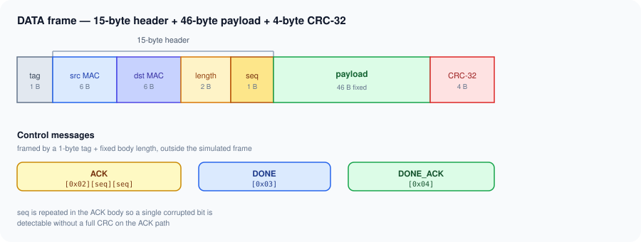

# C++-basic — Data Link Layer flow control

[](Makefile)
[](Makefile)
[](#what-it-implements-against-the-pdf)
[](#experiment-matrix-and-plots)
[](report/report.tex)

A direct, from-scratch implementation of Assignment 2 (`../Assignment-2-CO2-FlowControl.pdf`): **Stop-and-Wait**, **Go-Back-N**, and **Selective Repeat** ARQ running over one simulated, impairment-capable channel, carried on a real TCP socket.

This is a direct build — one CRC scheme, one fixed payload size, focused CRC/frame regression tests — in exchange for being small enough to read end to end. It still ships a full automated experiment matrix, SVG plots, and a generated LaTeX/PDF report.

For a complete, no-assumptions walkthrough of every module, read **[`explanation.md`](explanation.md)**.

## Contents

- [What it implements, against the PDF](#what-it-implements-against-the-pdf)
- [Wire format](#wire-format)
- [Build](#build)
- [Run a transfer](#run-a-transfer)
- [Sender / receiver flags](#sender-flags)
- [Sender output](#what-the-sender-prints)
- [Verifying a transfer](#manually-verifying-a-transfer)
- [Experiment matrix and plots](#experiment-matrix-and-plots)
- [Known simplifications](#known-simplifications)

## What it implements, against the PDF

| PDF requirement | Here |
| --- | --- |
| Frame: source/dest MAC (6+6), length (2), seq (1), payload, FCS | 15-byte header (the PDF's own diagram lists 6+6+2+1=15 and mislabels it "12"), fixed 46-byte payload, 4-byte CRC-32 trailer, matching the PDF's FCS size |
| `Framing()`, `Channel()`, `Send()`, `Timer()`, `Timeout()`, `Recv()` (sender) | [`frame.hpp`](include/frame.hpp), [`channel.hpp`](include/channel.hpp), [`wire.hpp`](include/wire.hpp) + [`socket.hpp`](include/socket.hpp), [`timer.hpp`](include/timer.hpp), used directly in each protocol's sender loop |
| `Recv()`, `Check()`, `Send()` (receiver) | same modules, used in each protocol's receiver loop |
| Stop-and-Wait, Go-Back-N(N), Selective Repeat(N) | [`stop_and_wait.*`](include/stop_and_wait.hpp), [`go_back_n.*`](include/go_back_n.hpp), [`selective_repeat.*`](include/selective_repeat.hpp) |
| Compare RTT / efficiency, clean and at 0.1-0.5 error/delay probability | [`tools/run_experiments.py`](tools/run_experiments.py) runs the automated matrix; [`tools/plot_results.py`](tools/plot_results.py) charts it (see [Experiment matrix and plots](#experiment-matrix-and-plots)) |

## Wire format



```text
DATA message:  [tag=0x01][src_mac 6][dst_mac 6][length 2][seq 1][payload 46][crc32 4]
ACK message:   [tag=0x02][seq][seq]              (seq repeated so a single-bit corruption is detectable without a full CRC on the ACK path)
DONE message:  [tag=0x03]                        (sender -> receiver: no more frames)
DONE_ACK:      [tag=0x04]                        (receiver -> sender: safe to exit)
```

The DATA body is 65 bytes; with its external tag, the TCP application message is 66 bytes. Its four-byte FCS is CRC-32/ISO-HDLC, stored most-significant byte first and computed over the 15-byte header plus all 46 padded payload bytes. The 1-byte tag plus each tag's fixed body length is the *external* TCP framing, kept outside the simulated frame so a corrupted simulated header cannot desynchronize the byte stream.

## Build

```bash
make -C C++-basic all      # strict C++17, -Wall -Wextra -Wpedantic -Werror
make -C C++-basic clean
```

Produces `C++-basic/build/sender` and `C++-basic/build/receiver`. Run `make test` from this directory for the CRC/frame regression checks, and `make test-integration` for 18 real TCP transfers covering all three protocols, empty/partial/full inputs, sequence wraparound, and combined impairment.

Prefer to click through a transfer interactively instead of typing flags?

```bash
./run_demo.sh   # builds, then prompts for protocol / window / impairment / input file
```

## Run a transfer

Start the receiver first (it blocks until a sender connects), then the sender. Stop-and-Wait's window is always 1; Go-Back-N and Selective Repeat need `--window` (1-255 for Go-Back-N, 1-128 for Selective Repeat).

```bash
# terminal 1
./build/receiver --protocol stop-and-wait --port 5000 --output output_files/received.txt

# terminal 2
./build/sender --protocol stop-and-wait --port 5000 --input test_data/input.txt
```

```bash
./build/receiver --protocol go-back-n --port 5000 --window 4 --output output_files/received.txt
./build/sender   --protocol go-back-n --port 5000 --window 4 --input test_data/input.txt
```

```bash
./build/receiver --protocol selective-repeat --port 5000 --window 4 --output output_files/received.txt
./build/sender   --protocol selective-repeat --port 5000 --window 4 --input test_data/input.txt
```

Add impairment with independent per-path probabilities (0.0-1.0):

```bash
./build/receiver --protocol go-back-n --port 5000 --window 4 --output output_files/received.txt --ack-error 0.2 --ack-loss 0.2 --seed 20

./build/sender --protocol go-back-n --port 5000 --window 4 --input test_data/input.txt --data-error 0.2 --data-loss 0.2 --seed 21
```

`--seed` controls that side's channel RNG independently, so DATA-path and ACK-path impairment are never coupled to the same random draw.

## Sender flags

| Flag | Meaning | Default |
| --- | --- | --- |
| `--protocol` | `stop-and-wait` \| `go-back-n` \| `selective-repeat` | required |
| `--input` | file to send | required |
| `--host` | receiver host | `127.0.0.1` |
| `--port` | receiver port | `5000` |
| `--window` | Go-Back-N/Selective Repeat only | `1` |
| `--data-error` | probability a sent frame gets one corrupted bit | `0.0` |
| `--data-loss` | probability a sent frame is dropped (models loss/excessive delay) | `0.0` |
| `--seed` | DATA-channel RNG seed | `1` |

## Receiver flags

Same shape, mirrored for the ACK path: `--protocol`, `--port`, `--output` (required), `--window` (Selective Repeat only — Go-Back-N's receiver window is fixed at 1 per the assignment), `--ack-error`, `--ack-loss`, `--seed` (default `2`).

## What the sender prints

One line per run:

```text
protocol=go-back-n elapsed_ms=159.0 frames_sent=36 retransmissions=24 acks_received=8 timeouts=4
```

- `elapsed_ms` — wall-clock transfer time (real time, not a simulated logical clock).
- `frames_sent` — every DATA transmission, including retransmissions.
- `retransmissions` — the subset of `frames_sent` that were retransmissions.
- `acks_received` — valid, matching ACKs (corrupted or stale ACKs don't count).
- `timeouts` — rounds where no ACK arrived before the current timeout.

From these you can compute what the PDF asks for:

- **Efficiency without impairment**: `(unique payload bytes) / (frames_sent * 65)` with `--data-error 0 --data-loss 0 --ack-error 0 --ack-loss 0`.
- **RTT**: not printed directly, but visible via the timer's effect — `elapsed_ms / frames_sent` on a clean run is a rough per-frame time; for a real RTT figure, watch how `elapsed_ms` and `timeouts` grow together as you raise `--data-error`/`--data-loss`/`--ack-error`/`--ack-loss` from 0.1 to 0.5.
- **Comparing the three protocols**: run the same `--input`, the same probability, and the same `--seed` values against each protocol in turn, and tabulate the printed lines yourself — or just use the automated matrix below.

## Manually verifying a transfer

```bash
cmp test_data/input.txt output_files/received.txt && echo "byte-identical"
```

## Experiment matrix and plots

Three standard-library-only Python tools (no dependencies to install) automate the PDF's comparison requirements:

```bash
python3 tools/generate_inputs.py   # adds test_data/tiny.txt (47 B) and medium.bin (1200 B) alongside the existing input.txt (537 B)
python3 tools/run_experiments.py   # runs the full matrix -> results/experiments.csv
python3 tools/plot_results.py      # renders results/plots/*.svg from that CSV

# or, equivalently:
make generate-inputs
make experiments   # builds first if needed, then generate-inputs + run_experiments.py
make plots
make results       # experiments + plots together
```

**Matrix design** (one-factor-at-a-time): for every input file and every protocol, one clean baseline run, then each of the four impairment paths (`data-error`, `data-loss`, `ack-error`, `ack-loss`) swept through probabilities 0.1-0.5 while the other three paths stay at 0. With the default 3 input files × 3 protocols × (1 baseline + 4 paths × 5 probabilities) = **189 runs**. Every run's reconstructed file is required to be byte-identical to its input, or the whole matrix aborts immediately (with the CSV rows written so far left intact). The CRC-32 run on **14 November 2026** passed all 189 transfers in 72.2 seconds and produced the checked-in `results/experiments.csv`, using 65 bytes per transmitted DATA frame in efficiency calculations (excluding tags and ACKs). The same (input file, path, probability) combination uses the same channel RNG seed for all three protocols; real timing and protocol-dependent RNG consumption can still affect comparisons.

`tools/plot_results.py` renders 13 SVG figures into `results/plots/` (open them in any browser): efficiency, completion time, and retransmission count vs. probability for each of the four impairment paths (12 figures, averaged across all input files, one line per protocol), plus one figure showing efficiency vs. input file size at the clean baseline. Pass `--mono` to render the same 13 figures in pure black (marker shape and line-dash pattern replace colour) into `results/plots_mono/`, for print or black-and-white use.

### PDF report

```bash
make report   # or: python3 tools/generate_report_tables.py, then pdflatex report/report.tex twice
```

Requires `pdflatex` and either `inkscape` or `rsvg-convert` (only for this target — the dataset and SVG plots above need neither). `tools/generate_report_tables.py` writes LaTeX table/macro fragments into `report/tables/` straight from `results/experiments.csv`, so every number `report/report.tex` quotes is mechanically derived from the dataset rather than hand-copied; the 13 color plots are converted to PDF into `report/figures/` and embedded as figures. Renders `report/report.pdf`, an 18-page write-up (design, implementation with source excerpts, test cases, the full results matrix, analysis, and known limitations) styled after the Assignment 1 report format.

> **Observed timing effect:** at the clean CRC-32 baseline, Go-Back-N recorded 7 retransmissions on `input.txt` and 6 on `medium.bin`; Selective Repeat recorded 6 and 1 respectively. All outputs were byte-identical. These counts vary with real wall-clock scheduling and the timer model in [Known simplifications](#known-simplifications), even when configured impairment is zero. The original run also showed baseline retransmissions. See `efficiency_vs_input_size_baseline.svg` for the current measurements.

## Known simplifications

- One FCS scheme (CRC-32), one fixed payload size (46 bytes) — not several schemes across a range of payload sizes.
- `RttTimer` is a plain EWMA (`timeout = 2 * smoothed_rtt`), not the full Jacobson SRTT/RTTVAR estimator with Karn's rule for ambiguous retransmitted samples. A retransmitted frame's ACK can still feed a sample into the estimator here; on a loopback link the effect is small; it can meaningfully skew the timeout on a genuinely lossy/variable link.
- Timing is real wall-clock time via `SO_RCVTIMEO`, not a deterministic logical clock — results are not bit-for-bit reproducible run to run, only statistically similar for the same seeds. This can also produce spurious timeouts/retransmissions under system load even with 0% configured impairment — see the baseline finding under [Experiment matrix and plots](#experiment-matrix-and-plots).
- No automated written report (`report.md`) generation — `tools/run_experiments.py` and `tools/plot_results.py` do automate the dataset and the charts (see [Experiment matrix and plots](#experiment-matrix-and-plots)), but turning them into prose is still a manual step.
- `make test` checks CRC-32 reference vectors, a golden 65-byte frame, all 520 single-bit corruption positions, malformed frames, padding, and sequence wraparound. The experiment matrix checks byte-identical transfers for all three protocols.
- `Channel::apply` reuses one RNG per side per run for both the loss draw and the corruption draw/position, rather than the full project's separately seeded selection/bit-position streams.
